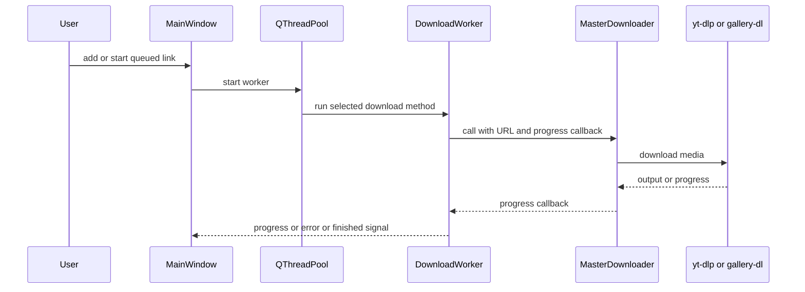

# MasterDownloader desktop application

MasterDownloader is a local PyQt6 downloader. `App.py` is the GUI entry point and owns the queue table, configuration, worker pool, and progress presentation. `MasterDownloader.py` owns platform downloads, archives, credential/session handling, and duplicate detection. There is no server, package API, or generated public surface in the inspected repository.

This is the download path wired by `MainWindow.start_download`, `DownloadWorker.run`, and the core methods documented in [social download workflows](../workflows/social-downloads.md). A separate `DuplicateWorker` uses the same signal model for [duplicate cleanup](../workflows/duplicate-cleanup.md).

## Runtime boundary and invariants

- `MainWindow.__init__` creates one `MasterDownloader` and a `QThreadPool`; `gui_config.json` sets `max_concurrent`, clamped by `_apply_max_concurrent` to 1 through 16.
- `start_download` selects exactly one core method based on the UI platform label: `download_instagram`, `download_tiktok`, or `download_facebook`. It passes the row folder as `output_folder` and injects the worker progress callback.
- `DownloadWorker` always emits `finished`, emits `error` only for raised exceptions, and sends ordinary return values via `result`. `handle_finished` marks a non-error row completed, so a downloader which reports a handled failure without raising can still finish at the UI level.
- Row identifiers are table indices. The source comments explicitly note that index changes need care; do not add sorting or reorder rows without revisiting worker-to-row tracking.
- `App.py` enables `faulthandler` logging to `crash.log` before creating `QApplication`.

Consult this page when changing UI dispatch, task concurrency, configuration, or local storage. Consult [social download workflows](../workflows/social-downloads.md) for downloader-specific return/error behavior, and [duplicate cleanup](../workflows/duplicate-cleanup.md) for scan results and deletion semantics.

## Local state and credential boundary

`MasterDownloader.__init__` resolves `base_dir` to the bundle directory when frozen, otherwise the source directory. It creates `sessions/` and `archives/`, loads `history.json`, initializes `deleted_md5.txt` under `archives/`, and runs archive and security migration.

Credentials and manual cookies are encrypted with a Fernet key managed by `_load_crypto_key`; `migrate_security` encrypts legacy plaintext credential/cookie content on startup. `set_manual_cookie` stores encrypted values and `get_manual_cookie` decrypts them for a downloader. Instagram sessions are kept under `sessions/` by `session_file_path`. Do not read, print, commit, or document values from `secret.key`, `cookies.json`, `ig_credentials.txt`, `sessions/`, or user configuration. `.gitignore` identifies these as application data or secrets.

Download archives are part of correctness: `_prepare_yt_dlp` checks that an archive can be opened and, only for `EINVAL`, attempts a reset before disabling archive-based deduplication for that invocation. Platform-specific archive selection is explained in [social download workflows](../workflows/social-downloads.md); deleted-file identity is separately recorded by [duplicate cleanup](../workflows/duplicate-cleanup.md).

## Running and packaging

- Linux/WSL: `StartApp.sh` chooses `.venv/bin/python` when available, otherwise creates `.venv` with `python3`; it installs `requirements.txt`, optionally upgrades dependencies when `UPDATE_LIBS=1`, checks the Qt xcb plugin on WSL, and executes `App.py`.
- Windows: `StartApp.bat` uses `.venv\Scripts\python.exe` when present, otherwise `python`, then runs `App.py`. It does not install dependencies.
- `build.bat` is the Windows PyInstaller command. It creates an onedir windowed `MasterDownloader` build and bundles `gui_config.json`, `history.json`, `ig_credentials.txt`, and `sessions`; treat those runtime mirrors as conditional release artifacts, not files to hand-edit.

Use the launch script for manual UI checks. A build is conditional: run `build.bat` only when changing packaging, frozen-path behavior, or a dependency needed by the bundled application.

## Change routing and validation

| Change | Start with | Focused check | Escalate when |
| --- | --- | --- | --- |
| Queue dispatch, progress, or completion state | `App.py`: `DownloadWorker`, `MainWindow.start_download`, `handle_progress`, `handle_finished`, `handle_error` | No focused non-GUI test exists; use a manual launch with `StartApp.sh` | The GUI changes task ownership, row identity, or thread-pool configuration |
| Configuration/default folders | `App.py`: `load_config`, `save_config`, `resolve_folder_for_url` | Manual launch; do not overwrite user configuration as a test fixture | Changing config schema or WSL folder discovery |
| Credentials, cookies, or session recovery | `MasterDownloader.py`: `migrate_security`, `get_manual_cookie`, `set_manual_cookie`, `get_ig_session` | Do not validate against real credentials; add isolated fixture tests first | Changing encryption format, key location, or frozen build data |
| Packaging/dependencies | `StartApp.sh`, `StartApp.bat`, `build.bat`, `requirements.txt` | Run the changed launcher | PyInstaller inputs or distribution behavior change |

The available focused GUI-related test is `tests/test_dedup_dialog.py`, which verifies that the duplicate dialog selects deletable paths but needs PyQt6 and uses `QT_QPA_PLATFORM=offscreen`. The full focused command is `.venv/bin/python -m unittest -q tests/test_dedup_dialog.py`.
