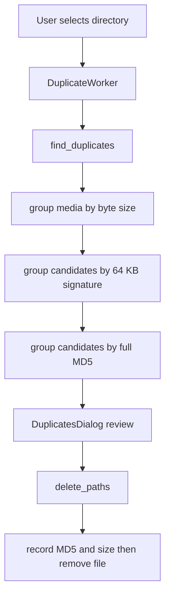

# Duplicate cleanup and deleted-file registry

This workflow lets a user scan a selected directory for duplicate media, review the proposed deletions, and record content identities before deletion. It is owned by `MasterDownloader.find_duplicates` and `delete_paths`, then surfaced asynchronously by `DuplicateWorker`, `DuplicatesDialog`, and `MainWindow.handle_scan_result` in [the desktop application](../architecture/desktop-application.md).

The scan also compares every nonempty supported media file whose size occurs in the deleted-file registry against a full MD5. Such a file is reported as “resurrected” unless it already belongs to a current duplicate group.

## Detection and selection rules

`_media_extensions` includes the video extensions from `_video_extensions` plus common image formats. `find_duplicates` skips roots containing `sessions`, `__pycache__`, `.git`, or `archives`.

The algorithm narrows work in three stages:

1. Group by byte size. A unique size cannot be a current duplicate.
2. For size groups with multiple paths, group using `_quick_signature`, a BLAKE2b digest of the first 65,536 bytes.
3. For signature groups with multiple paths, use `_file_hash`, which streams full content in 1 MiB chunks into MD5. Only a full-hash group with more than one file is a duplicate group.

Each duplicate group is sorted `(mtime, path)`, so index zero is the oldest file. `DuplicatesDialog` leaves index zero unchecked and selects later copies. It also selects all resurrected paths. The UI computes potential freed space from selected duplicates and resurrected files; actual removal happens only after dialog confirmation and `selected_paths` returns entries.

## Persistent deleted-file registry

At initialization, the core sets `deleted_md5_file` to `archives/deleted_md5.txt` and loads it with `_load_deleted_md5` into `dict[int, set[str]]`: byte size to MD5 digests. The text file uses one `md5,size` entry per line. Malformed lines, invalid sizes, missing files, and read errors do not prevent a scan.

`delete_paths` obtains size and MD5 **before** `os.remove`, then calls `_record_deleted_md5`. Recording is idempotent in memory and appends only an unseen digest/size pair. If hashing or persistence fails, deletion is still attempted; callers receive `(deleted_count, freed_bytes)`. The registry is not a general download archive: it records identities of user-selected removals, whereas downloader archives prevent repeat platform downloads as described in [social download workflows](social-downloads.md).

## Behavior matrix and focused tests

| Behavior/invariant | Focused test location |
| --- | --- |
| MD5 is a 32-character digest; missing file returns `None` | `FileHashTest.test_file_hash_returns_md5_hex` and `test_file_hash_missing_file_returns_none` in `tests/test_dedup_md5.py` |
| Registry round trip, idempotency, malformed input, missing file | `RegistryTest` in `tests/test_dedup_md5.py` |
| Delete records MD5/size before removing the file | `DeletePathsTest.test_delete_records_md5_and_removes_file` |
| Current identical files group together; a clean directory returns `([], [])` | `FindDuplicatesTest.test_returns_tuple_and_groups_current_dupes` and `test_clean_dir_returns_empty_tuple` |
| A unique file matching stored size and MD5 is resurrected; same-size different content is not | `test_detects_resurrected_unique_size_file` and `test_same_size_different_content_not_resurrected` |
| A registry match already in a duplicate group is not duplicated in resurrected results | `test_resurrected_file_that_is_also_duplicate_only_in_groups` |
| Default dialog selection retains first duplicate but selects later duplicates and resurrected files | `DialogResurrectedTest.test_resurrected_files_are_selectable` in `tests/test_dedup_dialog.py` |

## Change recipe and validation

When changing media eligibility, signatures, hashes, sort order, deletion, or UI selection:

1. Start at `find_duplicates` and map the change through `DuplicateWorker.run` to `handle_scan_result`. Scan output is always a two-item result: `(groups, resurrected)`.
2. Preserve the safety ordering: calculate full MD5 and record it with size before removal. Do not use size or the quick signature as final identity.
3. Preserve the overlap rule: remove resurrected paths that appear in groups before returning results.
4. For a new file extension, change `_media_extensions`; no downloader integration change is implied. For a new registry format, update both load and record behavior and migration expectations.
5. Run `.venv/bin/python -m unittest -q tests/test_dedup_md5.py tests/test_dedup_dialog.py`. The dialog test is PyQt6-dependent but configures offscreen Qt. A manual filesystem scan is conditional for performance or UX changes; use a disposable directory, not a user media library.

The registry lives below the local data boundary described in [the desktop application](../architecture/desktop-application.md). Never document its user-specific contents.
