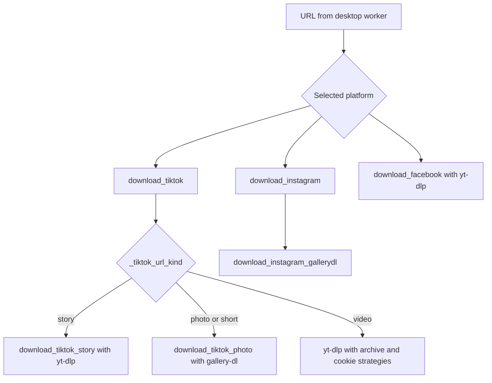

# Social media download workflows

`MainWindow.start_download` in [the desktop application](../architecture/desktop-application.md) maps UI labels to the three public core methods: `download_tiktok`, `download_instagram`, and `download_facebook`. Each accepts `url`, optional `output_folder`, and optional `progress_callback`. The callback is the only progress contract the GUI needs; a worker converts it into Qt signals.

The dispatch diagram reflects current behavior. Instagram's older `download_instagram_with_ytdlp` and the code following the early return in `download_instagram` are not reached by the public Instagram method today; do not assume those fallback paths are active without changing that return.

## Shared yt-dlp behavior

`_video_format` returns `bestvideo+bestaudio/best[vcodec!=none][acodec!=none]`. The preferred selector asks for separate best video and audio; the fallback must have both codecs. TikTok video/story, Instagram's gallery-dl yt-dlp bridge, and Facebook use this helper. `_prepare_yt_dlp` adds retry/rate-limiting defaults, discovers `ffmpeg` from `PATH` or `imageio-ffmpeg`, and handles unreadable or `EINVAL` download archives. Keep all consumers on this helper when changing format policy.

The focused format test is `VideoFormatTest.test_fallback_requires_video_and_audio` in `tests/test_video_format.py`.

## TikTok

`_tiktok_url_kind` classifies `/story/` and `/stories/` as stories, `/photo/` as photo posts, and `vm.tiktok.com` or `vt.tiktok.com` hosts as `short`; all others are video URLs. `download_tiktok` dispatches stories to `download_tiktok_story`, photos and short URLs to `download_tiktok_photo`, and ordinary videos through yt-dlp.

- **Video:** resolves an account from URL or yt-dlp metadata, resolves the output folder, merges legacy archive entries, and tries manual cookie, Edge cookies, then no cookies. It writes a per-folder yt-dlp archive and thumbnails.
- **Story:** normalizes `/story/{id}` to include a `/video/{id}` candidate and sorts that supported form first; it otherwise uses the same format and cookie strategy with a story-specific archive/name pattern.
- **Photo and short URLs:** invoke `python -m gallery_dl` with an output-folder SQLite archive, `extractor.tiktok.photos=true`, and `extractor.tiktok.audio=true`. A manual TikTok cookie, if available, becomes a temporary Netscape cookie file. Gallery-dl output lines are forwarded as `Running` progress; nonzero exit raises `RuntimeError`.

The short-host behavior is intentional in current source: it sends potentially unresolved short links to gallery-dl rather than the ordinary yt-dlp route. Test both `/@user/photo/...` and `https://vm.tiktok.com/...` when altering classification.

## Instagram

The public `download_instagram` delegates directly to `download_instagram_gallerydl`. That method strips query and trailing slash, classifies the URL with `_instagram_url_kind`, selects an include list, and starts `python -m gallery_dl`.

For profiles it includes `posts,reels,tagged,stories,highlights`; stories, highlights, and posts narrow that selection. The command has its own SQLite download archive, Instagram sleep/retry settings, cookie forwarding to gallery-dl's yt-dlp integration, the shared `_video_format`, and `extractor.instagram.audio=true`. A zero exit completes normally. A final output line indicating 429 starts the in-memory cooldown; login/cookie/private indicators report `Need Cookie`; other nonzero exits report `Error` without raising.

Manual Instagram cookies are encrypted at rest by the core's cookie helpers described in [the desktop application](../architecture/desktop-application.md). Do not inspect cookie values. Changes to authentication storage belong there; changes to gallery-dl options belong here.

## Facebook

`download_facebook` accepts video/post forms only: `/videos/`, `/watch`, `/reel/`, or `fb.watch/`. It rejects profile URLs before network work. It resolves the account from the URL or yt-dlp metadata, then uses the shared video format, a per-folder archive, thumbnails, and the Edge-cookie then no-cookie strategy. It raises the last error only after all strategies fail.

## Change recipe: adjust a downloader option or add a URL kind

1. Start with the public method and classifier in `MasterDownloader.py`; trace UI dispatch from `App.py: MainWindow.start_download` only if a platform label changes.
2. Preserve the correct backend boundary: yt-dlp options pass through `_prepare_yt_dlp`; gallery-dl behavior is assembled as a `cmd` list and launched with `subprocess.Popen`.
3. Preserve output-folder behavior and the matching archive mechanism. For gallery-dl routes, archives are SQLite files inside the output folder; yt-dlp routes use `_archive_path` and may merge legacy archive files.
4. If changing video/audio selection, update `_video_format` rather than an individual literal. Validate the fallback codec invariant with `tests/test_video_format.py`.
5. Add command-level tests by mocking `MasterDownloader.subprocess.Popen`, as `SocialMediaDownloadOptionsTest` does. Assert routing plus exact essential options, especially media/audio options; do not call real social services.
6. Run `.venv/bin/python -m unittest -q tests/test_social_media_download_options.py tests/test_video_format.py`. A manual download against a real account is conditional and requires a safe, authorized test URL; it is not a default check.

Changing `requirements.txt` is required when adding a new Python backend, and changing the desktop's accepted platform label also requires `App.py` UI routing. There is no package export, bundle mirror, or registration layer for these core methods beyond `MainWindow.start_download`.
